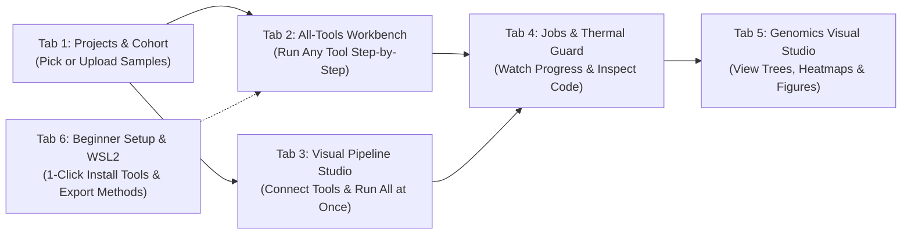

# GenomeLab™ — Complete User Notebook & Beginner Guide

Welcome to **GenomeLab™**! This notebook is written in simple, easy-to-follow sentences so that anyone—from a first-time student to an experienced researcher—can set up the app on their computer and run complete Whole-Genome Sequencing (WGS) analyses by clicking buttons instead of writing Linux code.

---

## 1. What is GenomeLab? (In Simple Words)

Normally, analyzing genome sequences requires typing many complex commands in a black Linux terminal (such as `fastqc`, `fastp`, `spades.py`, `prokka`, `abricate`, `roary`, and `iqtree`).

**GenomeLab** turns all of those command-line programs into a clean **White, Black, and Ash visual application** in your web browser:
1. **No coding needed**: You select your samples, click buttons to choose your settings, and press **Run**.
2. **Star (`★`) Recommendations for Every Step**: There are 85+ bioinformatics tools across 12 stages. GenomeLab puts a **`★ Gold Standard`** star next to the best tool for each step based on your organism, while still letting you choose any other tool if you want.
3. **Learn while you click**: Every tool and every finished job has a single button called **"Inspect Executed Code & Learn"**. Clicking it opens a window that shows you the exact Linux code that ran and explains every single option in plain English.
4. **Protects your laptop from overheating**: GenomeLab has a built-in **Thermal Guard** that limits CPU threads, caps RAM usage, and lets your laptop cool down between heavy genome assemblies.

---

## 2. How to Set Up GenomeLab on a New Computer (First-Time Setup)

If you are installing GenomeLab on a new Windows computer or sharing it with a friend, student, or lab colleague, follow these 3 simple steps:

### Step 1: Open the Project Folder
Copy the `GUI_Based_Genome_Analysis` folder to the computer.

### Step 2: Double-Click `setup_for_new_computer.bat`
- Find the file named [setup_for_new_computer.bat](file:///c:/Users/User/Desktop/GUI_Based_Genome_Analysis/setup_for_new_computer.bat) in the main folder and double-click it.
- A window will open and automatically:
  1. Check Python and install the backend server packages.
  2. Check Node.js and install the visual web interface packages.
  3. Ask if you want to automatically set up **WSL2 Ubuntu** and install all bioinformatics tools (`Miniforge3`, `FastQC`, `SPAdes`, `Prokka`, `ABRicate`, `Roary`, `IQ-TREE`, etc.). Type **`Y`** and press **Enter** to install them automatically.

### Step 3: Install or Check Tools Inside the App Anytime (1-Click)
Even if you skip installing Linux tools during Step 2, you can install them later inside the web app:
1. Open GenomeLab in your browser.
2. Click the **"1-Click Setup & Install Tools"** button at the top right (or open **Tab 6: Beginner Setup & WSL2**).
3. Click the black button **"1-Click Setup & Install ALL 70+ Tools"** (or click **"1-Click Install"** next to any single tool in the table).

---

## 3. How to Start GenomeLab Every Day

Whenever you want to use GenomeLab:
1. Go to the `GUI_Based_Genome_Analysis` folder.
2. Double-click [start_workbench.bat](file:///c:/Users/User/Desktop/GUI_Based_Genome_Analysis/start_workbench.bat).
3. Wait 3 seconds—your web browser will automatically open **http://localhost:5173** and show the **GenomeLab** home screen.

---

## 4. Choosing Your Organism & Following the `★ Gold Standard` Star Signs

At the top right of the screen, you will see a dropdown menu labeled **Organism**:
- **Bacteria (WGS & AMR)**: For *Salmonella*, *E. coli*, *Klebsiella*, *Staphylococcus*, and other bacteria.
- **Human & Animal (Diploid)**: For human, cattle, poultry, goat, swine, and other mammalian genomes.
- **Plant & Fungi**: For crops, plants, and fungal genomes.
- **Viruses & Phages**: For viral surveillance and bacteriophages.
- **Metagenomics**: For mixed microbiome samples (gut, soil, water, fecal).

**How the Star (`★`) System Works:**
- As soon as you select your organism, GenomeLab places a **`★ Gold Standard`** star badge on the best recommended tool for every single step.
- **If you are a beginner**: Simply pick the starred (`★`) tool in each stage!
- **If you are an advanced user**: You are never locked in—you can click and run any of the 85+ tools (`Velvet`, `MEGA11`, `RAST`, `Aragorn`, `HISAT2`, `DRAGEN`, `Picard`, `FreeBayes`, `BCFtools`, `DeepVariant`, `Circos`, `TBtools`, etc.) in any order you like.

---

## 5. Guide to All 6 Workspaces (Tabs) at the Top of the Screen



### Tab 1: `1. Projects & Cohort` (Manage Your Genomes & Samples)
This is where you organize your sequencing files:
- **Switch Projects**: Click on a project card at the top. GenomeLab comes pre-loaded with:
  1. **South Asian Livestock *Salmonella enterica* WGS (50 Genomes)** (connected to `/home/soumandeykakon/NGS_DA`).
  2. ***E. coli* Reference-Guided Variant Practice (`SRR2584863`)** (connected to `/home/soumandeykakon/wgs_practice`).
  3. **Beginner Guided Starter Project** (for practicing from Step 1 to Step 12).
- **Create a New Project from Scratch**: Click **"+ New Project"** to start your own study.
- **Browse WSL2 Files or Upload Local Files**: Click **"Browse WSL2 Files"** to pick `.fastq.gz` or `.fasta` files from your Ubuntu folders, or import NCBI SRA accession numbers (like `SRR2584863` or `ERR14794383`).
- **Select Samples for Analysis**: Use the checkboxes in the sample table to select **1 sample** or **all 50 samples** at once.

---

### Tab 2: `2. All-Tools Workbench` (Run Any of the 12 WGS Stages by Clicking Buttons)
Use this tab when you want to run tools one step at a time:
1. **Pick a Stage on the Left**: The left sidebar lists all **12 WGS Stages** in logical order (from *Stage 1: Raw Data Acquisition* to *Stage 12: Phylogenomics & Plots*).
2. **Pick a Tool**: Click any tool card. Tools with a **`★ Gold Standard`** badge are the top recommendations for your selected organism.
3. **Adjust Settings Using the 4 Simple Parameter Tabs**:
   - **Standard Options**: The main settings you need (buttons, dropdown menus, and ON/OFF switches). Each option has a beginner note explaining what it does.
   - **Advanced CLI Flags**: Extra scientific settings for complete control.
   - **Hardware & Thermal Guard**: Set how many CPU threads (e.g., `4`) and how much RAM (e.g., `8 GB`) the tool is allowed to use.
   - **Raw CLI Override**: A text box where advanced users can type any extra Linux flag if needed.
4. **Live Command Preview**: At the bottom of the settings panel, a dark box shows you the exact Linux command changing live as you click buttons.
5. **Run or Inspect**:
   - Click the black **"Run Tool Now"** button to execute the tool on your selected samples.
   - Click the ash **"Inspect Executed Code & Learn"** button to read a beginner explanation of every flag in that command.
   - Need a brand-new tool from GitHub? Click **"+ Register Custom CLI Tool"** at the top to add it to GenomeLab!

---

### Tab 3: `3. Visual Pipeline Studio` (Connect Tools Like Building Blocks)
Use this tab when you want to connect multiple tools together and run a complete pipeline automatically:
1. **Load a Ready-Made Pipeline (1 Click)**: Use the **Preset Selector** at the top to load a complete workflow, such as:
   - *Complete Bacterial WGS, AMR, Pan-Genome & Phylogeny (50-Genome Salmonella Standard)*
   - *Reference-Guided Alignment & Variant Calling (E. coli SRR2584863)*
   - *Human & Livestock Diploid Clinical WGS (GATK4 + DeepVariant + VEP)*
   - *Rapid Clinical AMR, PointFinder & Serotype Triage*
   - *Hybrid Illumina + Nanopore Complete Circular Genome Pipeline*
   - *Shotgun Metagenomic Taxonomic & Resistome Pipeline*
2. **Or Auto-Build the Gold-Standard Pipeline**: Click the **"★ Auto-Build Gold-Standard Pipeline"** button and GenomeLab will automatically place and connect all the recommended starred tools for your organism!
3. **Drag, Connect, and Customize**:
   - Drag tool boxes around the white canvas to arrange them.
   - Click any tool box on the canvas to open its settings on the right side.
   - Click **"Compile & Export Scripts"** to download the entire pipeline as a **Master Bash Script (`.sh`)** or a **Nextflow Workflow (`main.nf`)**.
   - Click the black **"Run Workflow"** button to run the entire chain from start to finish.

---

### Tab 4: `4. Jobs & Thermal Guard` (Watch Progress, Logs & Protect Your Laptop)
Use this tab to monitor your running and completed analyses:
1. **Hardware & Thermal Protection Bar**:
   - Choose your **Max CPU Threads** (`2T`, `4T`, `8T`, `12T`, `16T`), **Max RAM Limit** (`4GB`, `8GB`, `16GB`, `32GB`), and **Cooldown Pause** (`300s` = 5 minutes).
   - Keeping **4 Threads / 8 GB RAM / 300s Cooldown** turned **ON** ensures a consumer laptop never overheats or crashes during 50-genome assembly runs.
2. **Job Queue List**:
   - Shows every job with its progress bar (`100%`), time taken, and number of samples processed.
   - Every single job has a **"Inspect Executed Code & Learn"** button right on its row.
3. **Live Terminal Console**:
   - Click any job to see the real-time terminal log output at the bottom of the screen.

---

### Tab 5: `5. Genomics Visual Studio` (Interactive Charts, Trees & Publication Figures)
Use this tab to explore your scientific results and prepare figures for your research paper or thesis:
1. **AMR & Plasmid Resistome Matrix**: An interactive heatmap showing which isolates carry resistance genes (`aac(6')-Iaa`, `tet(A)`, `sul1`, `qnrS1`, `fosA7`, `floR`, `blaTEM-1B`, `blaCTX-M-15`) and plasmids (`IncX1`, `IncX2`, `IncFII`). You can filter by country, animal host, or multidrug-resistant (MDR) status.
2. **Interactive Phylogenetic Tree Studio**: View your evolutionary tree in **Rectangular** or **Circular** layout, zoom in/out, and inspect Country, Livestock Host, Sequence Type (ST), and AMR rings.
3. **Pan-Genome Architecture (Roary)**: View the Core, Soft-Core, Shell, and Cloud gene breakdown and pan-genome accumulation curve.
4. **Whole-Genome FastANI Matrix**: Inspect the pairwise nucleotide identity (98.5%–100%) heatmap across isolates.
5. **Assembly Quality (QUAST) & Virulome**: Compare N50, GC%, contig counts, and VFDB virulence genes (`invA`, `hilA`, `spvB`, `iroN`, `fimH`).
6. **Publication Scripts & iTOL Exporter**: Download ready-to-run **R `ggtree` scripts**, **Python `seaborn` heatmap scripts**, and **iTOL annotation files** with 1 click.

---

### Tab 6: `6. Beginner Setup & WSL2` (1-Click Tool Installer & Paper Methods Generator)
Use this tab to manage your computer's bioinformatics tools and export your paper's methodology:
1. **4-Step Beginner Setup Wizard**: Click a single button to verify/install Miniforge3, install all 70+ WGS tools, or format ABRicate and Prokka databases.
2. **All-Tools 1-Click Installer Table**: Search any of the 85 tools, check if it is installed in WSL2 Ubuntu, and click **"1-Click Install"** to install or update it.
3. **Automated Manuscript Materials & Methods Box**: At the bottom of the page, GenomeLab automatically writes a complete, publication-ready **Materials & Methods** paragraph listing every tool, version, parameter, and database used in your project. Click **"Copy for Manuscript"** to paste it straight into Microsoft Word or LaTeX!

---

## 6. How to Use the 1-Click "Inspect Executed Code & Learn" Window

One of the best features of GenomeLab for beginners is the **"Inspect Executed Code & Learn"** button (located in the top header bar, inside the Tools Workbench, on every Pipeline node, and on every Job).

When you click it, a clean pop-up window opens with **4 learning tabs**:
1. **Tab 1 — Exact CLI Command & Flag-by-Flag Guide**:
   - Shows the exact command that ran (for example: `spades.py --isolate -k 21,33,55,77 --cov-cutoff auto -t 4 -m 8 -1 R1.fq.gz -2 R2.fq.gz -o assembly`).
   - Breaks the command into pieces in a clear table: it tells you what `spades.py` is, what `--isolate` does, why `-k 21,33,55,77` was chosen, and why `-t 4 -m 8` protects your computer.
2. **Tab 2 — Automated Bash Batch Script (`.sh`)**:
   - Shows how to run that exact command across 50 genomes automatically using a Linux `for` loop, including the 5-minute laptop cooldown pause. You can copy it or click **Download `.sh`**.
3. **Tab 3 — Nextflow DSL2 Pipeline (`main.nf`)**:
   - Shows the modern Nextflow workflow version of your analysis for running on university servers or HPC clusters.
4. **Tab 4 — Conda Environment & Beginner Tips**:
   - Shows the `conda.yml` file and practical tips for checking your output files.

---

## 7. Complete Beginner Checklist: Running Your First Genome Analysis from Step 1 to Step 12

If you are starting from the very beginning with a new bacterial dataset, follow this simple checklist:

- [ ] **Step 1 (Choose Project & Organism)**: In the top bar, set **Organism** to `Bacteria (WGS & AMR)`. In **Tab 1 (`Projects & Cohort`)**, select your project (or click **+ New Project**) and check the boxes next to your samples.
- [ ] **Step 2 (Download or Check Raw Reads — Stage 1)**: Go to **Tab 2 (`All-Tools Workbench`)** → **Stage 1** → Click **`fasterq-dump` ★** (if downloading from NCBI SRA) and click **Run Tool Now**.
- [ ] **Step 3 (Check Raw Read Quality — Stage 2)**: Click **Stage 2** → Select **`FastQC` ★** and **`MultiQC` ★** → Click **Run Tool Now**.
- [ ] **Step 4 (Trim Adapters & Low-Quality Bases — Stage 3)**: Click **Stage 3** → Select **`fastp` ★** (keep *Auto-Detect Paired-End Adapters* and *Phred Quality 20* turned ON) → Click **Run Tool Now**.
- [ ] **Step 5 (Check Species Purity — Stage 4)**: Click **Stage 4** → Select **`Kraken2` ★** → Click **Run Tool Now**.
- [ ] **Step 6 (Assemble the Genome — Stage 5)**: Click **Stage 5** → Select **`SPAdes` ★** (keep `--isolate`, `-t 4`, `-m 8`) → Click **Run Tool Now**.
- [ ] **Step 7 (Check Assembly N50 & Completeness — Stage 6)**: Click **Stage 6** → Select **`QUAST` ★** and **`CheckM2` ★** → Click **Run Tool Now**.
- [ ] **Step 8 (Annotate Genes — Stage 7)**: Click **Stage 7** → Select **`Prokka` ★** (or **`Bakta` ★**) → Click **Run Tool Now**.
- [ ] **Step 9 (Find AMR, Virulence & Plasmid Genes — Stage 8)**: Click **Stage 8** → Select **`ABRicate` ★** (choose `resfinder` for AMR, `vfdb` for virulence, and `plasmidfinder` for plasmids) or **`NCBI AMRFinderPlus` ★** → Click **Run Tool Now**.
- [ ] **Step 10 (Find Sequence Type & Serovar — Stage 9)**: Click **Stage 9** → Select **`mlst` ★** and **`SeqSero2` ★** → Click **Run Tool Now**.
- [ ] **Step 11 (Build Pan-Genome & FastANI Matrix — Stage 10)**: Click **Stage 10** → Select **`Roary` ★** and **`FastANI` ★** → Click **Run Tool Now**.
- [ ] **Step 12 (Call Core SNPs & Build Evolutionary Tree — Stages 11 & 12)**: Click **Stage 11** → Run **`Snippy` ★** (or **`BWA-MEM` ★ + `GATK4` ★**), then click **Stage 12** → Run **`IQ-TREE 2` ★**.
- [ ] **Step 13 (Explore Figures & Copy Methods)**: Open **Tab 5 (`Genomics Visual Studio`)** to explore your heatmaps and phylogenetic tree, and open **Tab 6 (`Beginner Setup & WSL2`)** to copy your **Materials & Methods** paragraph!

> [!TIP]
> **1-Click Shortcut**: Instead of clicking Steps 2 through 12 one by one, open **Tab 3 (`Visual Pipeline Studio`)**, select the **50-Genome Salmonella WGS Standard Preset** (or click **"★ Auto-Build Gold-Standard Pipeline"**), and click **"Run Workflow"** to execute the entire chain automatically!

---

## 8. How to Create Folders/Subfolders in WSL2, Connect & Run the App, and Check Live WSL2 CLI

### Part A: 3 Easy Ways to Create Folders and Subfolders Inside WSL2

#### Method 1: 1-Click Inside the GenomeLab App (Easiest — No Commands Needed!)
1. Open **GenomeLab** in your browser and click **Tab 6 (`6. Beginner Setup & WSL2`)**.
2. Look at the **"1-Click WSL2 Folder & Subfolder Creator"** card on the left.
3. Type the folder path you want (for example: `/home/soumandeykakon/My_New_WGS_Project`).
4. Leave the checkbox **"Also create all 12 standard WGS step subfolders (`01_raw_data` to `13_figures`)"** checked.
5. Click the black button **"Create Folder & Subfolders in WSL2"**.
6. GenomeLab immediately creates the main folder and all 13 subfolders (`01_raw_data`, `02_quality_control`, `03_trimmed_reads`, `04_assembly`, `05_assembly_qc`, `06_annotation`, `07_amr_profiling`, `08_typing`, `10_plasmids`, `11_snp_phylogeny`, `12_pangenome`, `13_figures`, `logs`) inside your Ubuntu WSL2 filesystem!
   - *(Note: Creating a project via **+ New Project** in Tab 1 also creates these folders in WSL2 automatically!)*

#### Method 2: Using Windows File Explorer (Drag & Drop Like a Normal Windows Folder)
1. Open **Windows File Explorer** (press `Win + E`).
2. In the address bar at the top, type or paste:
   ```text
   \\wsl.localhost\Ubuntu\home\soumandeykakon
   ```
   and press **Enter** (or scroll down the left sidebar of File Explorer and click **Linux** → **Ubuntu** → **home** → **soumandeykakon**).
3. Now you can **Right-click → New → Folder** to create folders and subfolders, and **drag-and-drop your `.fastq.gz` or `.fasta` files** from Windows straight into WSL2!

#### Method 3: Using the WSL2 Ubuntu Terminal (`mkdir -p`)
1. Open your **Ubuntu (WSL)** terminal.
2. To create a single folder and a subfolder, run:
   ```bash
   mkdir -p /home/soumandeykakon/My_New_WGS_Project/01_raw_data
   ```
3. To create a main project folder and **all 12 standard WGS subfolders in one single command**, run:
   ```bash
   mkdir -p /home/soumandeykakon/My_New_WGS_Project/{01_raw_data,02_quality_control,03_trimmed_reads,04_assembly,05_assembly_qc,06_annotation,07_amr_profiling,08_typing,10_plasmids,11_snp_phylogeny,12_pangenome,13_figures,logs}
   ```
4. Check that your subfolders were created by typing:
   ```bash
   ls -la /home/soumandeykakon/My_New_WGS_Project
   ```

---

### Part B: How to Connect GenomeLab with WSL2 & Run the App

GenomeLab has a built-in **WSL2 Execution Bridge** ([wsl_executor.py](file:///c:/Users/User/Desktop/GUI_Based_Genome_Analysis/backend/wsl_executor.py)) that automatically connects Windows to your WSL2 Ubuntu distribution (`Ubuntu 22.04 LTS`) and your Conda environments (`/home/soumandeykakon/miniforge3/envs/ngs_veterinary`).

#### Option 1: Start from Windows (Recommended)
- Double-click **[start_workbench.bat](file:///c:/Users/User/Desktop/GUI_Based_Genome_Analysis/start_workbench.bat)** inside `c:\Users\User\Desktop\GUI_Based_Genome_Analysis`.
- Open **`http://localhost:5173`** in your browser.
- To connect any WSL2 folder to a project in the app:
  1. Go to **Tab 1 (`1. Projects & Cohort`)**.
  2. Click **"+ New Project"** and enter your WSL2 folder path (for example `/home/soumandeykakon/NGS_DA` or `/home/soumandeykakon/My_New_WGS_Project`), **OR** use the **WSL2 Ubuntu Live File Browser** at the bottom of Tab 1 to browse any folder inside WSL2.

#### Option 2: Run / Launch Directly From Inside WSL2 Ubuntu Terminal
If you are working inside your **Ubuntu WSL2 terminal**, every Windows C: drive folder is mounted at `/mnt/c/...`. You can run our dedicated WSL launcher script **[start_inside_wsl.sh](file:///c:/Users/User/Desktop/GUI_Based_Genome_Analysis/start_inside_wsl.sh)**:
```bash
cd /mnt/c/Users/User/Desktop/GUI_Based_Genome_Analysis
bash start_inside_wsl.sh
```
This script verifies your Linux kernel, checks your installed bioinformatics tools (`fastqc`, `fastp`, `spades.py`, `prokka`, `abricate`), lists your WSL2 workspaces, and launches GenomeLab!

---

### Part C: How to Check if GenomeLab is Working with WSL2 CLI Properly

You can verify that GenomeLab is talking to your real WSL2 Ubuntu CLI in **3 simple ways**:

1. **1-Click Live Diagnostic Inside the App (Tab 6)**:
   - Go to **Tab 6 (`6. Beginner Setup & WSL2`)** and look at the **"Live WSL2 CLI Connection & Tool Diagnostics"** card on the right.
   - Click the black **"Test WSL2 CLI Now"** button (or click the preset buttons like **"Check SPAdes & Prokka"**, **"List My WSL2 Home Folders"**, or **"List Conda Environments"**).
   - You can also type **any Linux command** in the box (for example `spades.py --version` or `ls -la /home/soumandeykakon/NGS_DA`) and click **"Run Command"**.
   - The black terminal box below it will immediately display the **real live output** returned by your WSL2 Ubuntu system!
2. **Run a Tool in `Live WSL2 Ubuntu Execution` Mode (Tab 2)**:
   - Go to **Tab 2 (`2. All-Tools Workbench`)**, select any installed tool (e.g. **FastQC**, **SPAdes**, or **ABRicate**), and in **Tab D (`Raw CLI Override`)** set the Execution Mode to **`Live WSL2 Ubuntu Execution`**.
   - Click **"Run Tool Now"**, then open **Tab 4 (`4. Live Job & Thermal Monitor`)**. You will see the `[WSL2 Ubuntu Live Binary Check]` line in the job logs showing the real version output from your Ubuntu environment.
3. **Test via Terminal Command (`curl` or `pytest`)**:
   - Run the automated test suite in PowerShell:
     ```powershell
     python -m pytest c:\Users\User\Desktop\GUI_Based_Genome_Analysis\backend\tests\test_api.py -v
     ```
   - All **8 automated tests** (including `test_wsl_mkdir_and_cli_diagnostics`) will pass (`8 passed`).

---

## 9. How to Create & Start Working on a Brand-New Project with a New Organism (Step-by-Step)

Follow these **6 simple steps** whenever you want to start a brand-new study with a new organism (for example, *Klebsiella pneumoniae*, *Staphylococcus aureus*, Cattle/Poultry diploid genomes, Rice/Plant genomes, Bacteriophages, or Metagenomic samples):

### Step 1: Open Tab 1 (`1. Projects & Cohort`) and Click `"Start Beginner Project (Step 1 → 12)"`
1. Make sure GenomeLab is open at **`http://localhost:5173`**.
2. In **Tab 1 (`1. Projects & Cohort`)**, click the black button at the top right labeled **"Start Beginner Project (Step 1 → 12)"**.

### Step 2: Fill In the 5 Boxes in the New Project Popup
1. **1. Project Name**: Type a name for your study (for example: `Klebsiella_Hospital_Study_2026` or `Cattle_WGS_2026`).
2. **2. Organism Kingdom (Sets `★` Tools)**: Choose the group your organism belongs to:
   - `Bacteria (WGS, AMR, Roary, Snippy)`
   - `Human & Animal Diploid (GATK4 / DeepVariant)`
   - `Plant & Fungal Genomes (HiFiasm / BUSCO / BRAKER)`
   - `Viruses & Bacteriophages (Host Depletion / Phage)`
   - `Metagenomics (Kraken2 / MEGAHIT / CheckM2)`
   *(Choosing this automatically puts `★ Gold Standard` star signs on the best tools for that organism across all 12 steps!)*
3. **3. Species / Strain Name**: Type the exact species name (for example: `Klebsiella pneumoniae`, `Bos taurus`, `Oryza sativa`, or `Avian Influenza`).
4. **4. WSL2 Directory Path**: Notice that GenomeLab automatically fills in `/home/soumandeykakon/GenomeLab_Workspaces/<Your_Project_Name>`. You can keep this or change it to any WSL2 folder you want.
5. **5. Initial Sample IDs or NCBI SRA Accessions**: Type your sample names or NCBI SRA accession numbers separated by commas (for example: `SAMPLE_01, SAMPLE_02` or `SRR2584863, ERR14794383`).
6. Click the black button **"Create & Launch"**.

**What GenomeLab Does Automatically When You Click "Create & Launch":**
- Creates your main project folder and all **12 standard WGS subfolders** (`01_raw_data` through `13_figures` + `logs`) inside WSL2 Ubuntu.
- Switches your active project to this new project and checks the boxes for your new samples.
- Updates the global **Organism Selector** in the top header so every stage highlights the right `★ Gold Standard` tools for your new organism.

### Step 3: Put Your Raw Sequencing Files (`.fastq.gz`) Into `01_raw_data` (2 Options)
- **Option A — If you have NCBI SRA Accession IDs (like `SRR2584863`)**:
  - You don't need to copy any files manually! Go to **Tab 2 (`2. All-Tools Workbench`)** → **Stage 1: Raw Data Acquisition** → Click **`SRA Toolkit fasterq-dump` ★** → Click **"Run Tool Now"**. It will download the paired `.fastq.gz` files straight into your project's `01_raw_data/` folder.
- **Option B — If you already have `.fastq.gz` or `.fasta` files on your computer**:
  - Open **Windows File Explorer** (`Win + E`), go to `\\wsl.localhost\Ubuntu\home\soumandeykakon\GenomeLab_Workspaces\<Your_Project_Name>\01_raw_data`, and **drag-and-drop your `.fastq.gz` files** into that folder (or click **"Browse WSL2 & Upload Files"** in Tab 1).

### Step 4: Choose How You Want to Run the Analysis (Step-by-Step OR All-at-Once)

#### Path 1: Run Step-by-Step in Tab 2 (`2. All-Tools Workbench`) — Best for Learning & Fine Control
1. Click **Tab 2 (`2. All-Tools Workbench`)** (or click any of the **Beginner Quick-Launch Highway** buttons in Tab 1).
2. On the left sidebar, click **Stage 2: Raw Read Quality Control (QC)** → Click the starred tool **`FastQC` ★** → Click **"Run Tool Now"**.
3. Next, click **Stage 3: Read Trimming & Filtering** → Click **`fastp` ★** → Click **"Run Tool Now"**.
4. Continue down the left sidebar from **Stage 4** to **Stage 12**, picking the **`★ Gold Standard`** starred tool for your organism at each stage (or any other tool you prefer):
   - **If Bacteria**: `Kraken2 ★` (Stage 4) → `SPAdes ★` (Stage 5) → `QUAST ★` + `CheckM2 ★` (Stage 6) → `Prokka ★` / `Bakta ★` (Stage 7) → `ABRicate ★` + `AMRFinderPlus ★` (Stage 8) → `mlst ★` (Stage 9) → `Roary ★` + `FastANI ★` (Stage 10) → `Snippy ★` (Stage 11) → `IQ-TREE 2 ★` (Stage 12).
   - **If Human / Livestock Animal (Diploid)**: `FastQC ★` (Stage 2) → `fastp ★` (Stage 3) → `BWA-MEM2 ★` + `SAMtools ★` + `Picard ★` + `GATK4 HaplotypeCaller ★` / `DeepVariant ★` + `SnpEff ★` / `Ensembl VEP ★` (Stage 11) → `IGV / Circos ★` (Stage 12).
   - **If Plant / Fungi**: `FastQC ★` (Stage 2) → `fastp ★` (Stage 3) → `Hifiasm ★` / `Flye ★` (Stage 5) → `QUAST ★` + `BUSCO ★` (Stage 6) → `MAKER / BRAKER3 ★` + `EggNOG-mapper ★` (Stage 7) → `IQ-TREE 2 ★` (Stage 12).

#### Path 2: Run the Entire Pipeline Automatically in Tab 3 (`3. Visual Pipeline Studio`) — Fastest!
1. Click **Tab 3 (`3. Visual Pipeline Studio`)**.
2. Click the button **"★ Auto-Build Gold-Standard Pipeline"** (or select a preset from the dropdown menu).
3. GenomeLab automatically places and connects all the recommended **`★ Gold Standard`** tools for your new organism on the visual canvas!
4. Click the black **"Run Workflow"** button to execute all steps automatically.

### Step 5: Watch Progress & Inspect the Executed CLI Code (Tab 4)
- Open **Tab 4 (`4. Jobs & Thermal Guard`)** to watch your jobs run with **Thermal Guard** protection (`4 Threads / 8 GB RAM / 300s Cooldown`).
- Click **"Inspect Executed Code & Learn"** on any job to see the exact Linux command, flag-by-flag beginner explanation, Bash batch script, and Nextflow workflow.

### Step 6: View Your Visual Results & Export Your Paper's Methods (Tabs 5 & 6)
- Open **Tab 5 (`5. Genomics Visual Studio`)** to explore your AMR & Plasmid heatmaps, Pan-Genome charts, FastANI matrix, and Interactive Phylogenetic Tree, and download R `ggtree` / Python `seaborn` / iTOL scripts.
- Open **Tab 6 (`6. Beginner Setup & WSL2`)** and click **"Copy for Manuscript"** at the bottom to copy your complete **Materials & Methods** paragraph!
